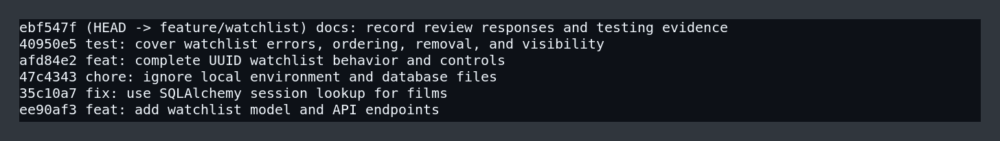

# PR Response Doc — CineLog Watchlist Feature

## AI Usage

I used an AI assistant to help orient me to the unfamiliar repository, compare the watchlist implementation with the existing collection-service pattern, and stress-test my design responses. I verified its suggestions against the actual source and tests. For the design discussion, I asked it to identify counterarguments to date-added ordering and public-by-default visibility. That prompted me to explicitly acknowledge privacy and discovery tradeoffs rather than presenting either choice as cost-free.

## Comment 1 — Rename

**What I did:** Renamed `save_to_watchlist()` to `add_to_watchlist()` in `services/watchlist_service.py` and updated the import and call site in `routes/watchlist/watchlist.py`. This matches the existing verb-to-noun convention established by `add_to_collection()`.

**How I verified:** I searched the full project for `save_to_watchlist` and confirmed there were no remaining references. I then ran `pytest tests/ -v`; all twelve tests passed.

## Comment 2 — Deduplication

**What I did:** Added an explicit duplicate check before inserting a `WatchlistEntry`, plus `AlreadyInWatchlistError`. I followed `add_to_collection()` in `services/collection_service.py`: query for an existing row matching both `user_id` and `film_id`, then raise a domain-specific exception if one exists. I also added a database-level unique constraint as a second line of defense against duplicate user/film pairs.

**How I verified:** `test_add_to_watchlist_duplicate_raises` adds the same film twice, verifies that the second call raises `AlreadyInWatchlistError`, and confirms that exactly one row remains.

## Comment 3 — Missing test

**What I did:** Added `tests/test_watchlist.py`, using `test_add_to_collection_nonexistent_film_raises` as the fixture and assertion model. The corresponding watchlist test passes an all-zero UUID and asserts that `FilmNotFoundError` is raised before any insert occurs.

**How I verified:** Both `pytest tests/test_watchlist.py -v` and the full `pytest tests/ -v` suite pass. Route-level tests also use Flask's test client to confirm that a missing film returns HTTP 404 and a duplicate returns HTTP 409 rather than escaping as a 500.

## Comment 4 — Default visibility

**My position:** Keep `public=True` as the default for CineLog, while allowing API callers to opt out explicitly with the new `public` parameter.

**Reasoning:** CineLog is described as a community film-tracking app, so a newly saved title being visible supports the product's discovery loop: other users can see what people plan to watch and use those lists as recommendations. Making the common social action require an extra flag would reduce participation, especially for lightweight API clients. The endpoint now accepts `public=False`, so privacy-conscious clients can make that choice at creation time instead of editing the entry later.

**Tradeoff acknowledged:** Public-by-default can surprise users who interpret a watchlist as private intent rather than community content. A mature UI should state the visibility beside the save action and remember a user's preference. If CineLog later shifts toward private personal tracking, or user research shows that people expect watchlists to be private, I would reverse the default. For this community-first version, explicit control plus a visible default is the better balance.

## Comment 5 — Sort order

**My position:** I changed watchlists from alphabetical order to newest-added first.

**Reasoning:** A watchlist is a queue of recent intent, not a reference catalog. Users are most likely to return for a title they just saved, so recency puts the most actionable items first and matches `get_collection()`'s established ordering. It also creates predictable behavior when titles begin with punctuation or articles such as “A” and “The.”

**Engagement with reviewer's point:** Alphabetical sorting is easier when a user already knows a title and has a long list. That is a real advantage, but it is better served by search or a user-selectable sort control than by discarding the temporal meaning of `date_added`. Until CineLog supports multiple sort modes, newest-first best reflects the primary “save now, watch soon” workflow.

## Comment 6 — Rebase

**What conflicted:** Rebasing `feature/watchlist` onto updated `main` produced a conflict in `models.py`. The feature branch defined `WatchlistEntry.film_id` as an integer, while `main` had migrated `Film.id` and `CollectionEntry.film_id` to 36-character UUID strings.

**How I resolved it:** I retained the watchlist relationship and index while changing `WatchlistEntry.film_id` to `db.String(36)` so it matches `Film.id`. I also updated watchlist documentation and tests to use UUID values. The feature branch was rebased rather than merged, so the history remains linear.

**How I verified no conflict remains:** `git diff --check` reports no conflict markers or whitespace errors, `git log --merges origin/main..HEAD` returns no commits, and all nine tests pass against the rebased models.

## Stretch Features

- Added `remove_from_watchlist(user_id, film_id)` and `NotInWatchlistError`, with tests for successful removal and the missing-entry case.
- Added extra duplicate, ordering, and visibility tests beyond the requested nonexistent-film test.
- Added a `public` request parameter to the add endpoint; `test_visibility_toggle` verifies an explicitly private entry.
- Added a `DELETE /watchlist/<user_id>/remove` endpoint and verified its 200/404 behavior through Flask's test client.

## HTTP and Module Boundaries

The watchlist routes translate service exceptions at the API boundary: unknown films return 404, duplicates return 409, missing request data returns 400, and removing a missing entry returns 404. Shared domain exceptions now live in `services/errors.py`, so the watchlist no longer imports an error from the unrelated collection service. Models and services import the shared SQLAlchemy instance from `extensions.py`, avoiding dependency on application import order. The nested route package now has an explicit `__init__.py`.

## Commit History



The branch contains only conventional, single-purpose commits and no merge commits.

## PR Description

### Overview

This PR completes CineLog's watchlist review cycle. It aligns the watchlist with the UUID refactor on `main`, renames the service API to match project conventions, prevents duplicate entries, sorts by recency, and adds tested removal and visibility controls.

### Design decisions

- Keep public visibility as the default for the community-first product, but expose an explicit opt-out.
- Sort by newest-added first to prioritize recent watch intent and match collection ordering.
- Enforce uniqueness in both service logic and the database schema.

### Testing

```bash
python -m venv .venv
source .venv/bin/activate
pip install -r requirements.txt
pytest tests/ -v
git diff --check
git log --merges origin/main..HEAD
```

Expected result: twelve passing tests, no diff errors, and no merge commits.

Manual endpoint verification:

1. `POST /watchlist/<user_id>/add` with a valid `film_id` returns 201 and the created entry.
2. Repeat that request and confirm it returns 409 with a JSON error.
3. Post an unknown UUID and confirm it returns 404 with a JSON error.
4. `GET /watchlist/<user_id>` returns newest-added films first and includes the `public` field.
5. `DELETE /watchlist/<user_id>/remove` returns 200 once, then 404 when repeated.
